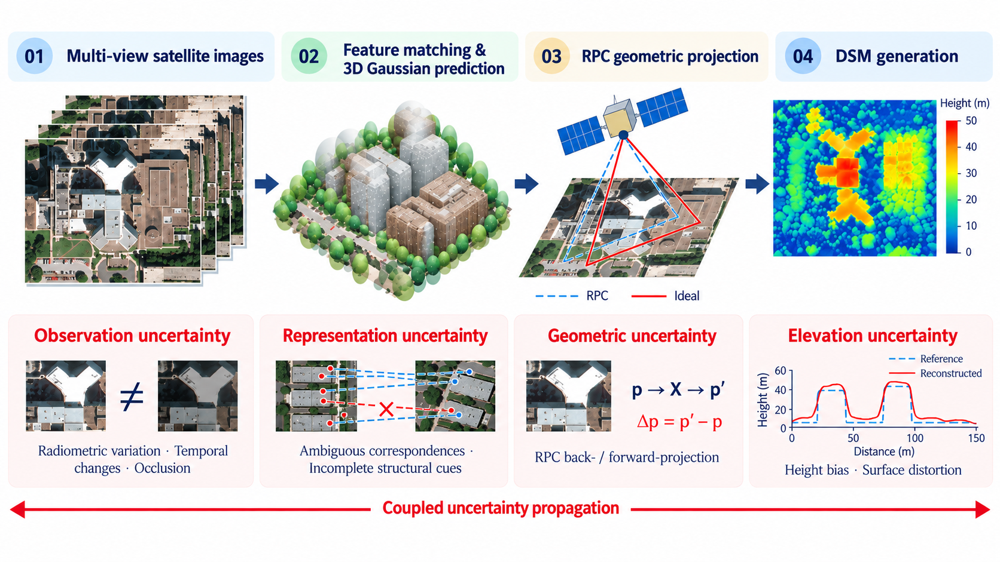

# 🛰️ CoupledSplat

### Modeling Coupled Uncertainties for Generalizable 3D Gaussian Splatting from Sparse-View Satellite Images

**Joint 3D reconstruction, elevation recovery, and novel-view synthesis from sparse-view satellite images.**

---

## 🔍 Abstract

Feed-forward 3D Gaussian splatting enables efficient reconstruction from multi-view satellite imagery, yet reliable 3D recovery remains challenging due to **coupled uncertainties throughout the reconstruction pipeline**. Radiometric variations, temporal changes, and occlusions undermine observation reliability and cross-view matching. Ambiguous correspondences and projection discrepancies can further compromise Gaussian geometry and elevation accuracy.

We introduce **CoupledSplat**, a unified uncertainty-aware framework for generalizable satellite reconstruction. Reliability-aware fusion adaptively weights image pairs and spatial regions, while semantic-structural matching combines semantic guidance with coarse-to-fine correspondence refinement. Newton-based RPC geometric refinement reduces projection discrepancies, and multi-scale elevation refinement addresses residual height errors through global height alignment and high-resolution surface constraints. Together, these components improve geometric accuracy and novel-view rendering quality.

## 🌍 Introduction

Sparse-view satellite imagery provides opportunities for large-scale 3D reconstruction and digital surface model generation. However, images acquired across different times and viewing conditions often exhibit appearance changes, occlusions, and ambiguous textures. Recovering accurate surfaces requires reliable multi-view evidence and consistent geometric projection.

We consider four connected sources of uncertainty—**observation, representation, geometry, and elevation**. Unreliable observations weaken correspondence estimation, while correspondence errors and projection discrepancies affect Gaussian positioning. These errors can propagate into the final surface as residual height offsets and local distortions.

  
   
  <em>Coupled uncertainties arise at different reconstruction stages and jointly affect surface recovery.</em>

## ⚙️ Method

### Overview

Building on SkySplat, CoupledSplat takes sparse-view satellite images and their **rational polynomial camera (RPC) models** as input and predicts a 3D Gaussian scene representation for novel-view rendering and elevation recovery.

The framework first combines image features with semantic-structural features from a frozen DA3 backbone to establish coarse-to-fine correspondences. Reliable observation fusion aggregates pairwise height distributions according to their local reliability. RPC-constrained geometric refinement improves projection consistency throughout matching and Gaussian construction. A shared refinement network then combines this evidence to refine heights and predict Gaussian attributes.

  
   
  <em>CoupledSplat integrates reliable observation fusion, semantic-structural matching, RPC-constrained geometry, and multi-scale elevation refinement.</em>

### 🤝 Reliable Observation Fusion

Each reference–source pair provides an independent height distribution. Spatial attention and attention across source pairs compare the available evidence to predict **pixel-wise reliability weights**. Applied at both coarse and fine matching stages, this fusion adapts to local observation quality and suppresses inconsistent contributions.

### 🧩 Semantic-Structural Matching

Adapted intermediate features from a **frozen DA3 backbone** complement image features with contextual and structural cues. RPC-guided coarse matching establishes an initial height estimate, followed by local fine matching with learned spatial sampling offsets. An uncertainty gate uses distribution ambiguity and disagreement across pairs to control refinement and blend the coarse and fine estimates.

### 📐 RPC-Constrained Geometric Refinement

A **Newton-based correction** refines inverse-RPC ground coordinates at a given height, with the RPC coefficients held fixed. This reduces forward-projection discrepancies and improves consistency in feature sampling and Gaussian positioning. A shared U-Net combines image, semantic, and geometric evidence to refine heights and predict Gaussian covariance, opacity, and appearance.

### 🏔️ Multi-Scale Elevation Refinement

A full-resolution residual prediction refines local surface details beyond the matching resolution. During training, complementary objectives support **relative surface structure, global height alignment, RGB reprojection consistency, and edge-aware smoothness**. These constraints guide elevation recovery at both global and local scales.

## 🙏 Acknowledgements

This work builds upon [SkySplat](https://github.com/NanCheng2001/SkySplat-main) and uses intermediate features from Depth Anything 3. We thank the authors for sharing their research and resources.
